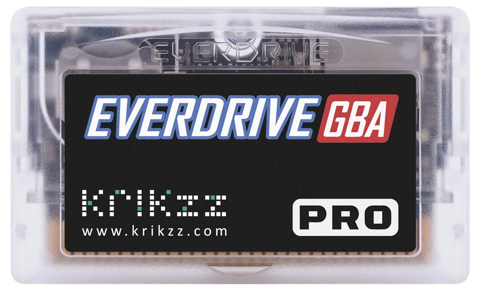

# EverDrive-GBA PRO Dev Sources

This repository contains libraries, tools and code examples for development targeting the [EverDrive-GBA PRO](https://krikzz.com/our-products/cartridges/everdrive-gba-pro.html).

Other supplementary resources are available from [here](https://krikzz.com/pub/support/everdrive-gba/pro-series/)
## Repo Contents
| Path                      | Description   |
|---                        |---            |
| [edio](./edio/)           | Example ROM for low level cartridge hardware access: SD card, Serial port, memory, etc. |
| [edio-cmd](./edio-cmd/)   | Test USB command scripts for the [edio](./edio/) ROM. |
| [edlink.py](./edlink.py)  | Basic cross-platform launcher script for [edlink.exe](./edlink.exe). Requires Mono runtime on Linux and macOS. |
| [edlink.exe](./edlink.exe)| USB utility for communication with EverDrive over USB, latest application source code is available [here](https://github.com/krikzz/edlink). |
## Debug UART Port

The EverDrive-GBA PRO has no built-in USB port, so the cartridge can only be connected to a PC through its debug UART port. This requires a USB-to-UART adapter capable of operating at 921600 baud and a 1.27 mm-pitch pin header adapter. See the [debug port pinout](./dbgport.jpg).
The UART port is located in the corner of the cartridge. Do not confuse it with the other similar-looking port.
Note that the UART adapter must be connected with RX and TX lines crossed (RX to TX and TX to RX).

The debug port allows you to launch applications and exchange debug information between the GBA and a PC.
Launching ROMs through the debug port requires firmware v26.1026 and edlink v1.0.0.3 or later.

---

